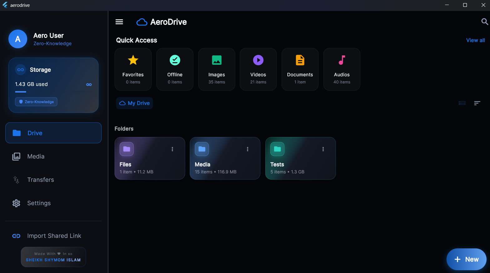
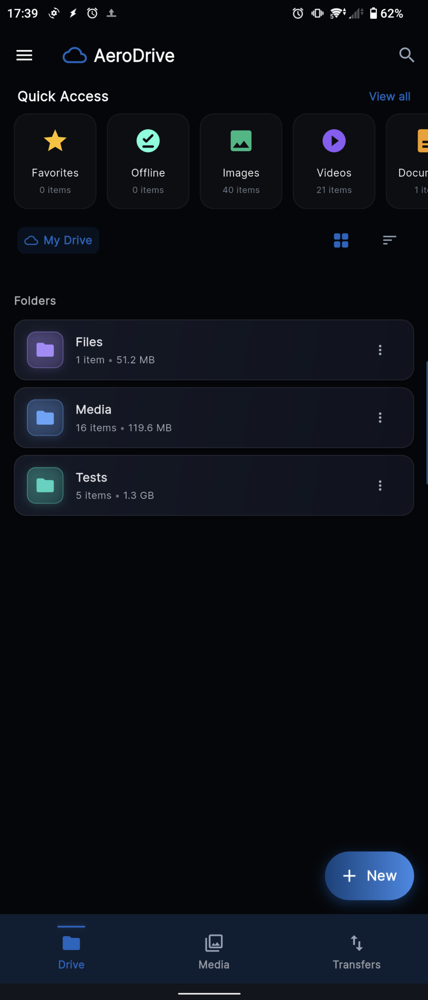
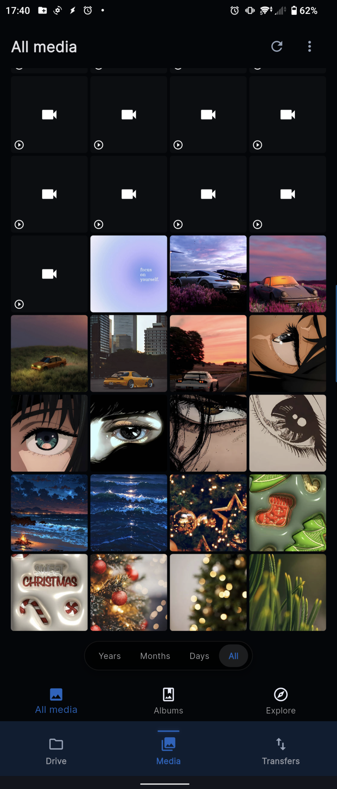
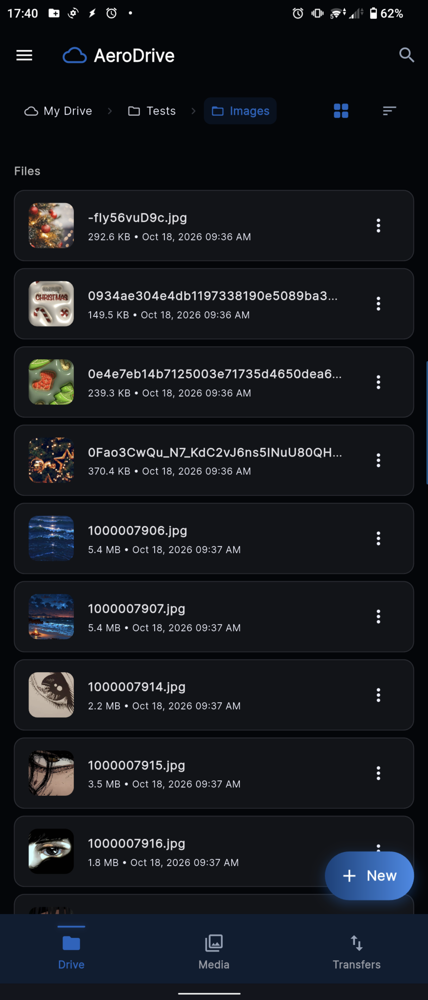
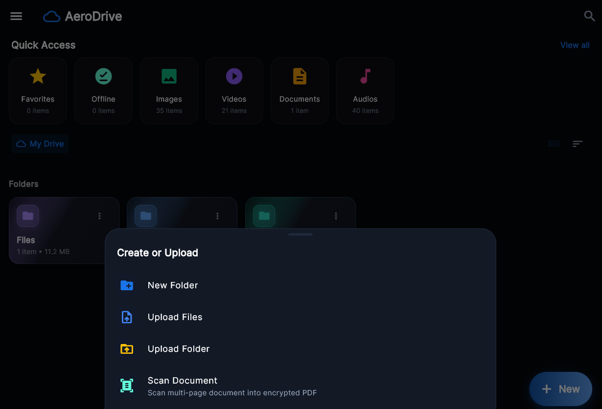

<div align="center">


# AeroDrive

**Zero-Knowledge Encrypted Cloud Storage — Powered Entirely by Telegram**

[](LICENSE)
[](https://flutter.dev)
[](https://core.telegram.org/tdlib)
[](https://golang.org)
[](#-cryptography--security-model)
[](#-quick-start)
[](https://shymom.github.io/AeroDrive)
[](https://flutter.dev)

[Features](#-features) · [Architecture](#-architecture) · [Security Model](#-cryptography--security-model) · [Quick Start](#-quick-start) · [Build from Source](#-building-from-source) · [Docs](#-documentation)

---



</div>

AeroDrive turns unlimited Telegram channels into a **private, high-performance, self-hosted cloud drive** — with no monthly fees and no server to maintain. Every file is **client-side encrypted** before it leaves your device using AES-256-GCM and Argon2id key derivation. Telegram never sees plaintext — not your filenames, not your photos, not your documents. You hold the only key.

It's a full-featured cross-platform app: a smart media gallery with on-device face clustering, 4K seekable video streaming, a document scanner, and instant zero-knowledge share links — with WebDAV network drive mounting planned on the active roadmap. All backed by an architecture that lets you recover your entire drive from scratch with a 24-word BIP-39 phrase.

---

## 📱 App Screenshots

<div align="center">

<table>
  <tr>
    <td align="center"></td>
    <td align="center"></td>
    <td align="center"></td>
  </tr>
  <tr>
    <td align="center"><em>Home Screen</em></td>
    <td align="center"><em>AI Smart Gallery</em></td>
    <td align="center"><em>File Manager</em></td>
  </tr>
</table>

<br/>


<br/><em>Desktop File Manager — Windows</em>

</div>

---

## ✨ Features

### 🛡️ Zero-Knowledge Security & Privacy
- **Infinite \$0 Storage** — Leverages Telegram's unlimited, free cloud infrastructure
- **End-to-End Client Encryption** — Raw data never leaves your device unencrypted; Telegram only receives high-entropy ciphertext blobs
- **AES-256-GCM** for static files with 128-bit authentication tags (tamper detection baked in)
- **AES-256-CTR** for streaming media — counter arithmetic enables instant seeking at any position in a 20 GB video
- **Argon2id Key Derivation** — Memory-hard, GPU/ASIC-resistant master key from your passphrase
- **HKDF-HMAC-SHA256 per-file subkey derivation** — unique 96-bit nonce per file, zero cryptographic reuse
- **BIP-39 24-word recovery phrase** — lose your device, not your files
- **Zero telemetry** — no third-party trackers, analytics, or crash reporters

### ⚡ Infinite Storage & Resilient Transfers
- **Multi-channel 3× striping** — distribute chunks across 2–5+ channels concurrently for parallel throughput and flood-wait bypass
- **Persistent transfer queue** — chunk-level progress, automatic retries with exponential backoff, pause/resume
- **Content-addressable deduplication (SHA-256)** — prevents redundant uploads across folders
- **Offline pinned files** — pin critical items for guaranteed offline availability, protected from cache cleanup
- **Zero-DB Disaster Recovery** — encrypted manifest channel lets you rebuild your entire drive index on a fresh device using only your passphrase

### 🧠 On-Device AI & Media Intelligence
- **Local face clustering** — Google ML Kit face detection + agglomerative cosine-distance clustering, no cloud calls ever (pet clustering planned on roadmap)
- **Interactive Places & Offline Geocoding** — embedded global city index (`cities.json`) for reverse geocoding; browse media by city, country, and geographic hotspots
- **Memories & Story Carousel** — "On this day", "Recent Adventures", and milestone albums, all generated on-device

### 📑 Productivity & Power Tools
- **Document scanner** — multi-page camera capture, B&W / Grayscale / Color Enhanced contrast filters, native PDF export (automatic perspective warping planned)
- **Storage Health & Duplicate Cleaner** — large-file analysis (>50 MB, >100 MB), content duplicate detection, one-tap cache trimmer
- **Google Takeout Importer** — ZIP archive importer for Google Photos/Drive; parses embedded JSON metadata (timestamps, EXIF, geo-coordinates) and recreates original folder trees

### 🎬 Universal In-App Previews
- **4K video streaming** — MediaKit (libmpv) with hardware decoding and instant AES-CTR seek anywhere in a large file
- **Document & Code Viewer** — vector PDF rendering (`pdfx`), syntax-highlighted code viewer, Markdown reader, ZIP/TAR inspection without full extraction
- **Biometric & App Lock** — fingerprint/face unlock (`local_auth`) or PIN, with configurable auto-lock timers and OS-level privacy shield (blurs previews in task switcher)

### 🌐 WebDAV & Cross-Platform Ecosystem
- **WebDAV mount** `[Roadmap / In Development]` — Planned companion daemon to mount AeroDrive as `Z:\` in Windows Explorer, macOS Finder, or Linux Nautilus
- **Secure share links** — password-protected, expiry-limited, burn-after-reading (self-destructs after first download)
- **Cloudflare Tunnel / Tailscale compatible** — remote sharing & planned WebDAV access without opening firewall ports

---

## 🏛️ Architecture

AeroDrive separates UI state, local persistence, encryption primitives, and Telegram network transport into clean, isolated layers:

```
┌────────────────────────────────────────────────────────────────────────┐
│                        Flutter Client Application                      │
│                                                                        │
│   ┌─────────────────────┐   ┌──────────────────┐   ┌───────────────┐  │
│   │   Riverpod State    │   │  GoRouter Nav    │   │ Material 3 UI │  │
│   └──────────┬──────────┘   └────────┬─────────┘   └───────┬───────┘  │
│              │                       │                     │          │
│   ┌──────────▼───────────────────────▼─────────────────────▼───────┐  │
│   │                    Domain Services Layer                       │  │
│   │  • UploadQueueService    • FaceClusteringEngine   • Cleaner    │  │
│   │  • TakeoutImporter       • DocumentScannerService • OfflinePin │  │
│   └──────────┬─────────────────────────────────────────────────────┘  │
│              │                                                        │
│   ┌──────────▼──────────────┐                ┌─────────────────────┐  │
│   │  Drift SQLite Database  │                │ Cryptography Engine │  │
│   │  Schema v5 + FTS5 Search│                │ AES-256-GCM / CTR   │  │
│   └──────────┬──────────────┘                └──────────┬──────────┘  │
│              │                                          │             │
│   ┌──────────▼──────────────────────────────────────────▼──────────┐  │
│   │                   TDLib FFI Native Bridge                      │  │
│   │        tdjson.dll (Windows) / libtdjson.so (Android/Linux)     │  │
│   └──────────────────────────────────┬─────────────────────────────┘  │
└──────────────────────────────────────┼─────────────────────────────────┘
                                       │
                                       ▼ (TLS 1.3 / MTProto)
              ┌────────────────────────────────────────────┐
              │         Telegram Cloud Infrastructure      │
              │  • Storage Channels (Encrypted Blobs)      │
              │  • Manifest Channel (Zero-DB Recovery Feed)│
              └────────────────────────────────────────────┘
                                       ▲
                                       │ (Localhost / Tunnel)
┌──────────────────────────────────────┴─────────────────────────────────┐
│                  Go WebDAV Companion Server (Optional)                 │
│   • chi HTTP Engine      • WebDAV Filesystem Driver    • Share Proxy  │
└────────────────────────────────────────────────────────────────────────┘
```

The Flutter app owns all cryptographic logic — the Go server and Telegram infrastructure are treated as **untrusted transports**. The local Drift/SQLite database is an index only; the manifest channel is the source of truth.

---

## 🔐 Cryptography & Security Model

AeroDrive treats Telegram purely as an untrusted, high-capacity blob store. All cryptographic boundaries exist on-device.

| Security Layer | Algorithm / Standard | Purpose |
|---|---|---|
| **Master Key Derivation** | **Argon2id** | Passphrase + Salt → 256-bit Master Key. Resists GPU dictionary attacks. |
| **Static File Encryption** | **AES-256-GCM** | Authenticated encryption with 128-bit auth tags — tamper detection included. |
| **Streaming Media** | **AES-256-CTR** | Seekable segment-based streaming; counter arithmetic enables random-access decryption. |
| **Subkey Derivation** | **HKDF-HMAC-SHA256** | Derives distinct ephemeral keys per file, channel, and manifest entry. |
| **Nonce Generation** | **96-bit random nonce** | Unique per file, generated by `cryptography` package (CSPRNG). |
| **Deduplication Hashing** | **SHA-256** | Content-addressable digests for duplicate detection — zero plaintext exposure. |
| **Secrets Storage** | **Android Keystore / Windows DPAPI** | Hardware-backed key storage via `flutter_secure_storage`. |
| **Recovery Phrase** | **BIP-39 (12 words)** | Mnemonic encoding of the master seed for offline backup. |

### Zero-DB Disaster Recovery

If you lose your device or your local database is corrupted, **you lose nothing**:

1. AeroDrive publishes an encrypted **manifest event** to a private Telegram channel on every upload, rename, and move.
2. Enter your Master Passphrase on any new device and trigger **Manifest Rescan**.
3. AeroDrive replays the entire manifest stream, fully rebuilds your SQLite index and folder hierarchy — no server, no account recovery email, no support ticket.

---

## 🚀 Quick Start

<details>
<summary><strong>📱 Android — ARM64 APK</strong></summary>

1. Download the latest `app-release.apk` from the [**Releases**](https://github.com/SHYMOM/AeroDrive/releases) page.
2. Enable **Install from Unknown Sources** in your Android settings.
3. Install the APK (Android 8.0+ required).
4. Launch AeroDrive and sign in with your Telegram phone number and 2FA password.
5. Create a **Master Passphrase** to initialize your encrypted drive. Write down your 24-word BIP-39 recovery phrase and store it somewhere safe.

</details>

<details>
<summary><strong>💻 Windows — Portable .exe</strong></summary>

1. Download `AeroDrive_Windows_Portable.zip` from the [**Releases**](https://github.com/SHYMOM/AeroDrive/releases) page.
2. Extract the archive to a folder of your choice.
3. Confirm that `tdjson.dll` is present in the same directory as `aerodrive.exe`.
4. Launch `aerodrive.exe`.
5. Sign in with your Telegram credentials and set your Master Passphrase.

</details>

<details>
<summary><strong>🌐 Go WebDAV Companion Server — Mount as Z:\ drive [Roadmap / In Development]</strong></summary>

> **Note:** The WebDAV network drive integration is currently under active development and not yet available in the stable release builds.

Once released, you will be able to build and run the companion backend to mount AeroDrive as a standard network drive:

```bash
cd backend
go build -o aerodrive-server ./cmd/server
./aerodrive-server --port 8090 --db-path ./data
```

**Mount on Windows:**
```
net use Z: http://localhost:8090 /persistent:yes
```

**Mount on Linux (davfs2):**
```bash
sudo mount -t davfs http://localhost:8090 /mnt/aerodrive
```

> **Tip:** Pair with a [Cloudflare Tunnel](https://developers.cloudflare.com/cloudflare-one/connections/connect-networks/) or [Tailscale](https://tailscale.com) to access your WebDAV mount securely from anywhere — no open ports required.

</details>

---

## 🛠️ Building from Source

### Prerequisites

| Tool | Version | Notes |
|---|---|---|
| Flutter SDK | `3.22.0+` | Dart 3 required |
| Android SDK | Build tools `34.0.0+`, NDK `25+` | For Android builds |
| Visual Studio 2022 | C++ Desktop workload | For Windows desktop builds |
| Go | `1.22+` | For WebDAV companion server |
| TDLib | `1.8.x` | `tdjson.dll` (Windows) / `libtdjson.so` (Android/Linux) |

### Steps

**1. Clone the repository**
```bash
git clone https://github.com/SHYMOM/AeroDrive.git
cd AeroDrive
```

**2. Configure environment**

Copy and populate the `.env` file in the `app/` directory:
```env
TELEGRAM_API_ID=your_telegram_api_id
TELEGRAM_API_HASH=your_telegram_api_hash
```
> Obtain your API credentials at [my.telegram.org](https://my.telegram.org).

**3. Install Flutter dependencies**
```bash
cd app
flutter pub get
```

**4. Run Dart code generation** (Drift + Riverpod)
```bash
dart run build_runner build --delete-conflicting-outputs
```

**5. Build**

```bash
# Android APK
flutter build apk --release
# → app/build/app/outputs/flutter-apk/app-release.apk

# Windows desktop
flutter build windows --release
# → app/build/windows/x64/runner/Release/aerodrive.exe
```

**6. Run tests**
```bash
flutter test
```

**7. Build the Go WebDAV server**
```bash
cd ../backend
go build -o aerodrive-server ./cmd/server
```

---

## 📂 Project Structure

```
AeroDrive/
├── app/                          # Flutter client application
│   ├── android/                  # Android native project & JNI libs
│   ├── windows/                  # Windows native runner & CMake
│   ├── assets/                   # Embedded city database & static assets
│   ├── lib/
│   │   ├── core/                 # Routing, themes, crypto primitives, Drift DB
│   │   ├── domain/               # Upload queue, AI clustering, scanner, importer
│   │   └── features/             # Drive browser, Media, Scanner, Cleaner, Security, Settings
│   └── test/                     # Unit and integration test suites
├── backend/                      # Go WebDAV companion & share proxy
│   ├── cmd/server/               # WebDAV binary entrypoint
│   └── internal/webdav/          # WebDAV protocol handlers
├── docs/                         # Architecture, Security, API specifications & website
└── scripts/                      # Native build helpers and codegen automation
```

---

## 🔧 Tech Stack

| Layer | Technology |
|---|---|
| **UI Framework** | Flutter 3.22+ / Dart 3 |
| **Telegram Transport** | TDLib C++ via `dart:ffi` (`tdjson.dll` / `libtdjson.so`) |
| **Backend Server** | Go 1.22+ · chi router · WebDAV *(In Development)* |
| **Local Database** | Drift SQLite · Schema v5 · FTS5 full-text search |
| **State Management** | Riverpod |
| **Navigation** | go_router |
| **Cryptography** | `cryptography` package — AES-256-GCM/CTR, Argon2id, HKDF |
| **Secure Storage** | `flutter_secure_storage` — Android Keystore / Windows DPAPI |
| **Video Playback** | MediaKit (libmpv) |
| **On-Device AI** | Google ML Kit (`google_mlkit_face_detection`, `google_mlkit_image_labeling`) |

---

## 📖 Documentation

| Document | Description |
|---|---|
| [ARCHITECTURE.md](docs/ARCHITECTURE.md) | Deep-dive into the layered architecture, data flow, and design decisions |
| [SECURITY.md](docs/SECURITY.md) | Full cryptographic specification, threat model, and security audit notes |
| [API.md](docs/API.md) | Go WebDAV server API reference and share-link protocol |
| [COMPLIANCE.md](docs/COMPLIANCE.md) | GDPR, data residency, and regulatory compliance notes |

🌐 **Project website:** [shymom.github.io/AeroDrive](https://shymom.github.io/AeroDrive)

---

## 🤝 Contributing

Contributions are welcome and appreciated! Please open an issue before submitting large changes so we can discuss the approach. For bug reports, include your platform, AeroDrive version, and steps to reproduce.

1. Fork the repository
2. Create a feature branch: `git checkout -b feat/your-feature`
3. Commit your changes: `git commit -m 'feat: add your feature'`
4. Push and open a Pull Request

Please follow the existing code style and ensure `flutter test` passes before opening a PR.

---

## 📄 License

This project is dual-licensed:

- **Flutter app** (`app/`) — [GNU Affero General Public License v3.0 (AGPL-3.0)](LICENSE)
- **Go companion server** (`backend/`) — [MIT License](backend/LICENSE)

The AGPL-3.0 was chosen deliberately: if you deploy AeroDrive as a network service, you must release your modifications. This ensures the ecosystem stays open and that improvements flow back to everyone.

---

<div align="center">
  <sub>Built with ❤️ by the AeroDrive community · Dedicated to zero-knowledge privacy and open access · <a href="https://shymom.github.io/AeroDrive">shymom.github.io/AeroDrive</a></sub>
</div>
