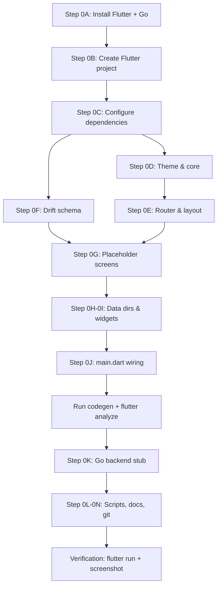

# Phase 0 — AeroDrive Scaffolding (Revised)

Scaffold the entire AeroDrive repository and set up the development environment from scratch on a Windows machine.

---

## Decisions Finalized

All open questions from v1 are resolved:

| Decision | Choice | Rationale |
|---|---|---|
| **License** | **AGPL-3.0** | Protects against derivative SaaS forks; appropriate for a privacy-focused storage tool handling user data. AGPL ensures any network-accessible derivative must share source. |
| **Go HTTP router** | **chi v5** | Actively maintained, lightweight, excellent middleware composability. gorilla/mux is in maintenance-only mode. |
| **Hashing algorithm** | **SHA-256** via `cryptography` + `cryptography_flutter` | No actively-maintained standalone BLAKE3 Dart package exists. SHA-256 has native hardware acceleration on all platforms via `cryptography_flutter`. The speed difference is negligible for our use case (bottleneck is encryption + network I/O, not hashing). `r_crypto` (Rust/Blake3) would add complex native binary dependencies for marginal benefit. |
| **TDLib version** | **Latest stable tag** from `github.com/tdlib/td` | Will be resolved at Phase 1 build time. Script will clone and build from latest stable. |
| **Flutter SDK** | **Latest stable channel** | Will be installed fresh via `git clone` method (recommended for Windows). |

---

## Current System Inventory

| Tool | Status | Location |
|---|---|---|
| **Git** | ✅ v2.54.0 | Installed |
| **Java** | ✅ JDK 17.0.12 | Installed |
| **Android SDK** | ✅ Full SDK | `D:\Drivers\AndroidSDK` (platforms 34-36.1, build-tools 34-37, NDK 27.x, cmdline-tools, emulator) |
| **winget** | ✅ v1.28 | Available for package management |
| **Flutter** | ❌ Not installed | Needs installation |
| **Dart** | ❌ Not installed | Bundled with Flutter |
| **Go** | ❌ Not installed | Needs installation |
| **Docker** | ❌ Not installed | Needed for TDLib build (Phase 1, not Phase 0) |
| **Disk space** | ✅ 240 GB free on E: | Plenty |

---

## Execution Plan

### Step 0A — Environment Setup (Prerequisites)

> [!IMPORTANT]
> This step installs Flutter SDK and Go on your machine. These are one-time installs that will persist.

#### 0A.1 — Install Flutter SDK
- Install Flutter SDK via `git clone` to `C:\flutter` (official recommended method for Windows)
- Add `C:\flutter\bin` to system PATH
- Configure Flutter to use existing Android SDK at `D:\Drivers\AndroidSDK`
- Run `flutter doctor` to verify everything connects
- Accept Android licenses via `flutter doctor --android-licenses`

#### 0A.2 — Install Go
- Install Go via `winget install GoLang.Go`
- Verify with `go version` (expecting Go 1.22+)

#### 0A.3 — Verify Environment
```powershell
flutter --version    # Flutter stable, Dart 3.x
flutter doctor       # All checks green (except Chrome/VS may show warnings — OK)
go version           # Go 1.22+
```

---

### Step 0B — Flutter Project Creation

#### 0B.1 — Create Flutter app
```powershell
cd e:\Projects\AeroDrive
flutter create --org com.aerodrive --project-name aerodrive --platforms android,windows,linux,macos,web app
```
This creates the full Flutter project structure inside `app/` with Android as primary target and all other platforms scaffolded for future use.

#### 0B.2 — Configure Android
- Set `minSdkVersion 24` in `app/android/app/build.gradle`
- Point to Android SDK at `D:\Drivers\AndroidSDK`
- Configure ABI filters: `arm64-v8a`, `armeabi-v7a`, `x86_64`
- Set `compileSdkVersion 36` and `targetSdkVersion 36`

---

### Step 0C — Dependencies & Configuration

#### [MODIFY] [pubspec.yaml](file:///e:/Projects/AeroDrive/app/pubspec.yaml)
Replace the default pubspec with all pinned dependencies:

**Dependencies:**
```yaml
dependencies:
  flutter:
    sdk: flutter
  # State Management
  flutter_riverpod: ^2.6.1
  riverpod_annotation: ^2.6.1
  # Routing
  go_router: ^17.2.3
  # Local Database
  drift: ^2.34.0
  drift_flutter: ^0.3.1
  path_provider: ^2.1.5
  # Cryptography
  cryptography: ^2.7.0
  cryptography_flutter: ^2.3.2
  flutter_secure_storage: ^9.2.4
  # Utilities
  uuid: ^4.5.1
  ffi: ^2.1.3
  freezed_annotation: ^2.4.6
  json_annotation: ^4.9.0
  google_fonts: ^6.2.1
  intl: ^0.19.0

dev_dependencies:
  flutter_test:
    sdk: flutter
  # Code Generation
  drift_dev: ^2.34.0
  build_runner: ^2.15.0
  riverpod_generator: ^2.6.1
  freezed: ^2.5.7
  json_serializable: ^6.9.0
  # Linting
  flutter_lints: ^5.0.0
  riverpod_lint: ^2.6.1
  # Testing
  mocktail: ^1.0.4
```

#### [NEW] [analysis_options.yaml](file:///e:/Projects/AeroDrive/app/analysis_options.yaml)
Strict Dart analysis rules with `riverpod_lint` custom rules.

---

### Step 0D — Theme & Core Infrastructure

#### [NEW] [aerodrive_theme.dart](file:///e:/Projects/AeroDrive/app/lib/core/theme/aerodrive_theme.dart)
Full Material 3 dark-mode-first theme:
- **Background**: deep space blue-purple `#0B0C24`
- **Surface**: slightly lighter `#12132B`
- **Primary accent**: electric violet `#7C3AED` → `#8B5CF6` (lighter variant)
- **Secondary accent**: electric cyan `#06B6D4` → `#22D3EE`
- **Error**: coral red `#EF4444`
- **On-surface text**: `#E2E8F0` (high contrast)
- Typography: Inter (body) + Outfit (headings) via `google_fonts`
- Full component theming: cards with subtle borders, glassmorphic-ready surfaces, rounded corners, elevation system

#### [NEW] [app_colors.dart](file:///e:/Projects/AeroDrive/app/lib/core/theme/app_colors.dart)
Named color constants as a sealed class — single source of truth.

#### [NEW] [app_text_styles.dart](file:///e:/Projects/AeroDrive/app/lib/core/theme/app_text_styles.dart)
Text style presets bound to the theme tokens.

#### [NEW] [constants.dart](file:///e:/Projects/AeroDrive/app/lib/core/constants.dart)
App-wide constants:
- `kMaxChunkSizeBytes = 1.5 * 1024 * 1024 * 1024` (1.5 GB)
- `kMaxConcurrentUploads = 4`
- `kTrashRetentionDays = 30`
- Breakpoints: `kMobileBreakpoint = 600`, `kDesktopBreakpoint = 1024`

#### [NEW] [app_error.dart](file:///e:/Projects/AeroDrive/app/lib/core/app_error.dart)
Sealed error class hierarchy:
- `NetworkError`, `CryptoError`, `TelegramError`, `StorageError`, `AuthError`

#### [NEW] [extensions.dart](file:///e:/Projects/AeroDrive/app/lib/core/extensions.dart)
Extension methods on `int` (file size formatting), `DateTime` (relative time), `String` (truncation).

---

### Step 0E — Routing & Responsive Layout

#### [NEW] [app_router.dart](file:///e:/Projects/AeroDrive/app/lib/core/routing/app_router.dart)
`GoRouter` with `ShellRoute` for the main navigation shell. Routes:
- `/drive` — file browser (default)
- `/upload-queue` — upload queue
- `/search` — search
- `/trash` — trash/bin
- `/settings` — settings

#### [NEW] [responsive_scaffold.dart](file:///e:/Projects/AeroDrive/app/lib/core/routing/responsive_scaffold.dart)
`LayoutBuilder`-based scaffold:
- `≥ 1024px` → persistent sidebar with AeroDrive logo + nav items
- `600–1023px` → collapsible `NavigationRail`
- `< 600px` → `NavigationBar` (bottom nav)

All three layouts share the same route destinations.

---

### Step 0F — Drift Database Schema (Empty, Codegen-Ready)

All tables per §3.2 of the brief:

#### [NEW] [database.dart](file:///e:/Projects/AeroDrive/app/lib/data/db/database.dart)
Main `@DriftDatabase` class referencing all 9 tables, schema version 1.

#### [NEW] Table files in `app/lib/data/db/tables/`:

| File | Table | Key Columns |
|---|---|---|
| `folders_table.dart` | `folders` | `id (uuid pk)`, `parentId`, `name`, `createdAt`, `updatedAt`, `isTrashed`, `trashedAt` |
| `files_table.dart` | `files` | `id`, `folderId`, `name`, `mimeType`, `sizeBytes`, `sha256Hash` (indexed), `encryptionNonce`, `encryptionAlgo`, `manifestVersion`, `createdAt`, `updatedAt`, `isTrashed`, `trashedAt`, `isFavorite` |
| `chunks_table.dart` | `chunks` | `id`, `fileId`, `chunkIndex`, `channelId`, `accountId`, `telegramMessageId`, `telegramFileId`, `sizeBytes`, `chunkHash`, `uploadStatus` (enum) |
| `channels_table.dart` | `channels` | `id`, `telegramChatId`, `displayName`, `isActive`, `isHidden`, `quotaUsedBytes` |
| `accounts_table.dart` | `accounts` | `id`, `telegramUserId`, `phoneNumberMasked`, `sessionEncrypted (blob)`, `isActive` |
| `manifest_messages_table.dart` | `manifest_messages` | `id`, `channelId`, `telegramMessageId`, `manifestVersion`, `payloadJson` |
| `thumbnails_table.dart` | `thumbnails` | `fileId`, `encryptedBlob`, `width`, `height` |
| `share_links_table.dart` | `share_links` | `id`, `fileId/folderId`, `token`, `passwordHash`, `expiresAt`, `maxDownloads`, `downloadCount`, `burnAfterReading` |
| `upload_queue_table.dart` | `upload_queue` | `id`, `filePath`, `status`, `priority`, `retryCount`, `lastError` |

> [!NOTE]
> The column `blake3Hash` from the brief is renamed to `sha256Hash` per our hashing decision. All references in code and docs will use SHA-256 consistently.

---

### Step 0G — Placeholder Feature Screens

Minimal placeholder screens — each renders centered text with the AeroDrive theme styling so we can verify routing and theming works:

| Path | File |
|---|---|
| `app/lib/features/auth/auth_screen.dart` | Login placeholder |
| `app/lib/features/drive/drive_screen.dart` | File browser placeholder |
| `app/lib/features/upload_queue/upload_queue_screen.dart` | Upload queue placeholder |
| `app/lib/features/preview/preview_screen.dart` | Preview placeholder |
| `app/lib/features/search/search_screen.dart` | Search placeholder |
| `app/lib/features/trash/trash_screen.dart` | Trash placeholder |
| `app/lib/features/sharing/sharing_screen.dart` | Sharing placeholder |
| `app/lib/features/settings/settings_screen.dart` | Settings placeholder |

---

### Step 0H — Placeholder Data Directories

Create empty directories with `.gitkeep`:
- `app/lib/data/telegram/` — TDLib FFI bindings (Phase 1)
- `app/lib/data/crypto/` — EncryptionEngine (Phase 2)
- `app/lib/data/repositories/` — Repositories (Phase 3)
- `app/lib/domain/` — Entities and use-cases (Phase 3+)

---

### Step 0I — Shared Widgets

#### [NEW] [aerodrive_logo.dart](file:///e:/Projects/AeroDrive/app/lib/widgets/aerodrive_logo.dart)
Animated AeroDrive logo widget with:
- Cloud + upload arrow icon composition
- Subtle shimmer/glow animation using the electric violet accent
- Used in sidebar header and splash/auth screens

---

### Step 0J — Main Entry Point

#### [NEW] [main.dart](file:///e:/Projects/AeroDrive/app/lib/main.dart)
```dart
void main() {
  WidgetsFlutterBinding.ensureInitialized();
  runApp(
    const ProviderScope(
      child: AeroDriveApp(),
    ),
  );
}
```
- `AeroDriveApp` uses `MaterialApp.router` with `GoRouter`
- Applies `AeroDriveTheme.dark` theme
- Title: "AeroDrive"

---

### Step 0K — Go Companion Backend

#### [NEW] [go.mod](file:///e:/Projects/AeroDrive/backend/go.mod)
```
module github.com/aerodrive/backend

go 1.22

require github.com/go-chi/chi/v5 v5.x.x
```

#### [NEW] [cmd/server/main.go](file:///e:/Projects/AeroDrive/backend/cmd/server/main.go)
Minimal chi server:
- `GET /healthz` → `{"status":"ok"}`
- Graceful shutdown on `SIGINT`/`SIGTERM`
- Structured logging to stdout
- Port configurable via `PORT` env var (default 8080)

#### [NEW] Placeholder internal packages (`.gitkeep`):
- `backend/internal/telegram/`
- `backend/internal/linkstore/`
- `backend/internal/streaming/`
- `backend/internal/httpapi/`

#### [NEW] [Dockerfile](file:///e:/Projects/AeroDrive/backend/Dockerfile)
Multi-stage: `golang:1.22-alpine` builder → `alpine:3.20` runtime.

#### [NEW] [docker-compose.yml](file:///e:/Projects/AeroDrive/backend/docker-compose.yml)
Single service: Go backend on port 8080.

---

### Step 0L — Scripts

#### [NEW] [scripts/build_tdlib.sh](file:///e:/Projects/AeroDrive/scripts/build_tdlib.sh)
Documented stub for TDLib cross-compilation:
- Clones `github.com/tdlib/td` latest stable
- Uses Docker + Android NDK for `arm64-v8a`, `armeabi-v7a`, `x86_64`
- Outputs `libtdjson.so` per ABI to `app/android/app/src/main/jniLibs/<abi>/`
- Full implementation deferred to Phase 1

#### [NEW] [scripts/run_codegen.sh](file:///e:/Projects/AeroDrive/scripts/run_codegen.sh)
```bash
cd app && dart run build_runner build --delete-conflicting-outputs
```

#### [NEW] [scripts/run_codegen.ps1](file:///e:/Projects/AeroDrive/scripts/run_codegen.ps1)
Windows PowerShell equivalent of the above.

---

### Step 0M — Documentation

#### [NEW] [README.md](file:///e:/Projects/AeroDrive/README.md)
- Project overview & mission statement
- License rationale (AGPL-3.0)
- Tech stack table
- Phased roadmap summary
- Quick-start instructions stub

#### [NEW] [LICENSE](file:///e:/Projects/AeroDrive/LICENSE)
Full AGPL-3.0 license text (GNU Affero General Public License v3.0).

#### [NEW] [docs/ARCHITECTURE.md](file:///e:/Projects/AeroDrive/docs/ARCHITECTURE.md)
High-level architecture:
- System diagram (Mermaid): Flutter app → TDLib FFI → Telegram cloud; Go backend for share links
- Data flow overview
- Encryption model outline
- Stub sections for each phase

#### [NEW] [docs/COMPLIANCE.md](file:///e:/Projects/AeroDrive/docs/COMPLIANCE.md)
Per §0 of brief:
- Users are responsible for Telegram ToS compliance
- Tool is for personal backup/storage of content user has rights to
- Flood-wait signals must be respected (back off, not bypass)
- Multi-account usage must respect Telegram's rate limits

#### [NEW] [docs/SECURITY.md](file:///e:/Projects/AeroDrive/docs/SECURITY.md)
Stub with threat model outline — expanded in Phase 2 (encryption) and Phase 9 (duress PIN).

#### [NEW] [docs/API.md](file:///e:/Projects/AeroDrive/docs/API.md)
Stub — populated in Phase 8 (Go backend endpoints).

---

### Step 0N — Git Configuration

#### [NEW] [.gitignore](file:///e:/Projects/AeroDrive/.gitignore)
Comprehensive ignore rules for:
- Flutter: `.dart_tool/`, `build/`, `.flutter-plugins*`, `*.g.dart`, `*.freezed.dart`
- Dart: `.packages`, `pubspec.lock` (for apps it should be committed, but we'll include it)
- Android: `local.properties`, `*.jks`, `.gradle/`
- Go: binary outputs
- IDE: `.idea/`, `.vscode/settings.json`
- Secrets: `.env`, `*.key`, `*.pem`
- TDLib: `*.so`, `*.dylib` (binary artifacts)
- OS: `Thumbs.db`, `.DS_Store`

---

## Verification Plan

### Automated Tests

```powershell
# 1. Flutter analysis — zero warnings
cd e:\Projects\AeroDrive\app
flutter analyze

# 2. Code generation succeeds (Drift + Riverpod + Freezed)
cd e:\Projects\AeroDrive\app
dart run build_runner build --delete-conflicting-outputs

# 3. Flutter test baseline passes
cd e:\Projects\AeroDrive\app
flutter test

# 4. App boots to themed home screen
cd e:\Projects\AeroDrive\app
flutter run -d windows    # or android emulator if available

# 5. Go module compiles
cd e:\Projects\AeroDrive\backend
go build ./cmd/server/

# 6. Go vet passes
cd e:\Projects\AeroDrive\backend
go vet ./...
```

### Manual Verification
- Screenshot of the themed empty home screen (dark mode, space blue `#0B0C24` background, AeroDrive logo, navigation working)
- Confirm responsive layout by resizing window on Windows desktop
- Confirm sidebar → nav rail → bottom nav transitions at breakpoints

---

## File Count Summary

| Category | New Files |
|---|---|
| Flutter app (`lib/`) | ~25 |
| Flutter config (pubspec, analysis_options) | 2 |
| Android config modifications | 1 |
| Go backend | ~6 |
| Scripts | 3 |
| Documentation | 5 |
| Root config (.gitignore, LICENSE, README) | 3 |
| **Total** | **~45** |

---

## Execution Order



---

## Next Phase Preview

**Phase 1 — Telegram Client Foundation** will cover:
- Docker install (needed for TDLib build)
- TDLib `.so` cross-compilation via `scripts/build_tdlib.sh`
- `dart:ffi` bindings for the 5 tdjson C functions
- `TdClient` wrapper with JSON request/response typed models
- Phone + OTP auth flow UI (Material 3 themed)
- Multi-account session manager
- Session encryption and persistence
- Integration test: log in with a real Telegram account
